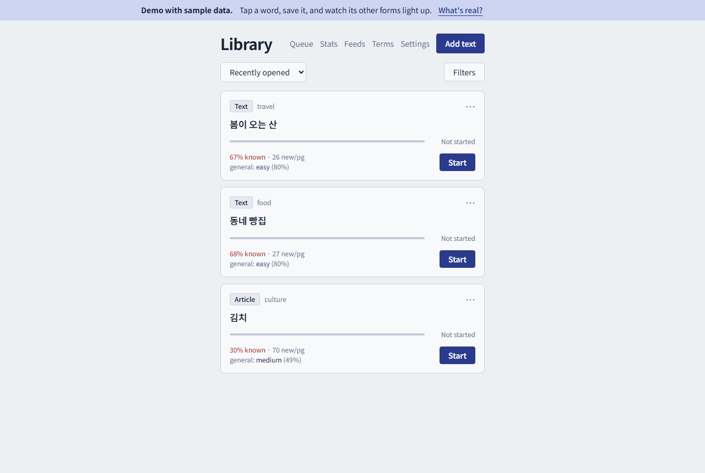
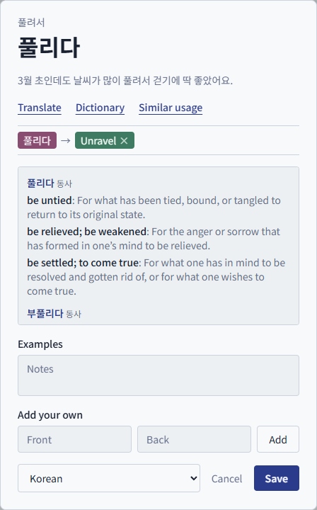
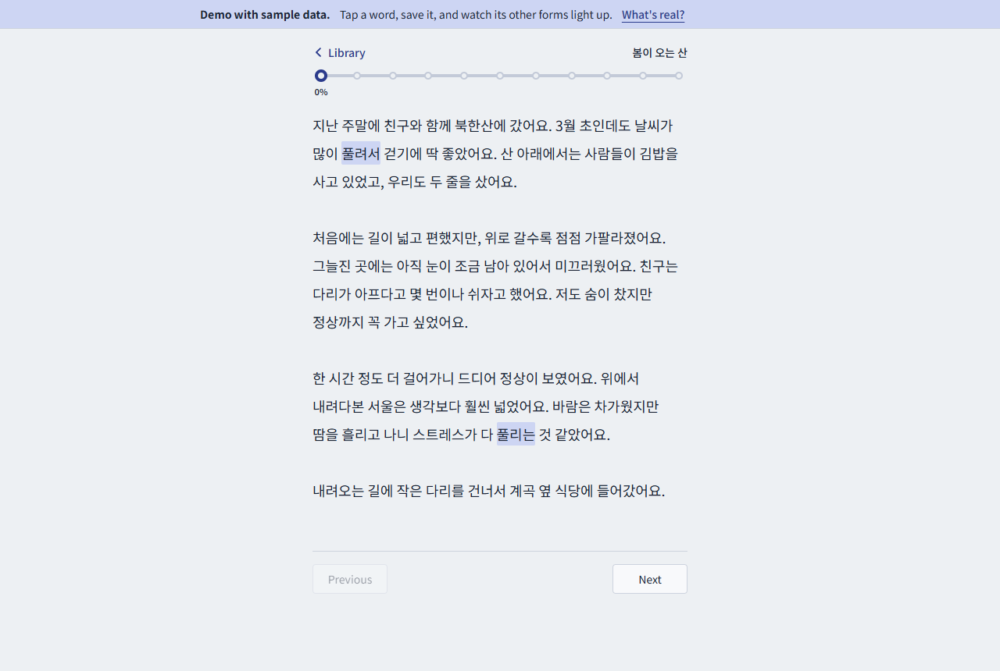
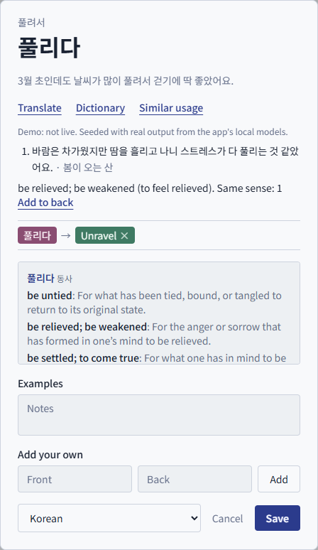
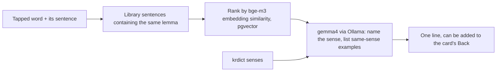
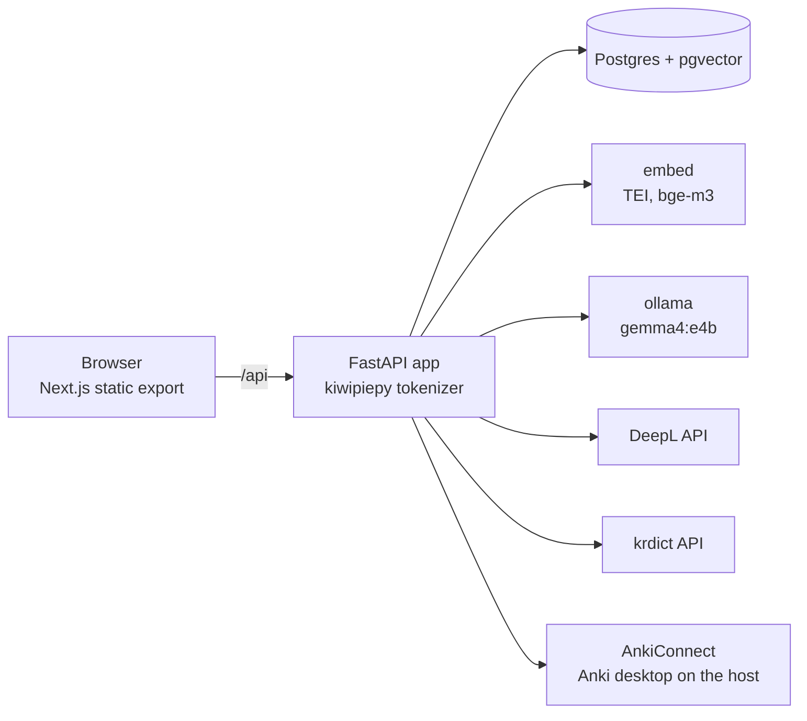
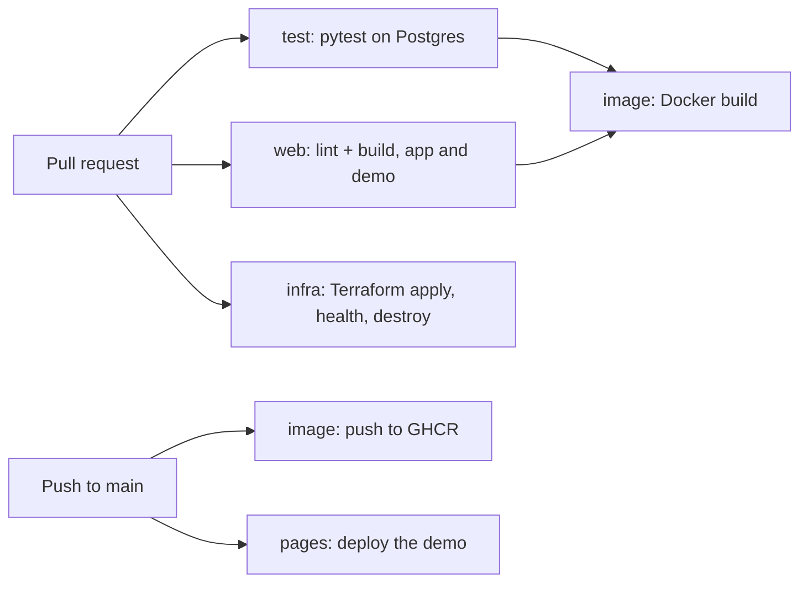

# MbxRead: features and how they work

*Reference doc: the project explainer. Setup and running are in the [README](../README.md);
the as-built detail is in [ARCHITECTURE.md](ARCHITECTURE.md), the reasons in
[DECISIONS.md](DECISIONS.md).*

MbxRead is a reading app for learners of Korean. You read real texts, tap the words you
don't know, build a flashcard for each one, and sync the cards to Anki. It runs on your
own machine in Docker; the language models run locally too, with no paid API.

**Try it:** [live demo](https://miobix.github.io/MbxRead-public/) (static, sample texts,
your saved words stay in your browser).

## The core loop

1. **Pick a text.** The library scores every text for *you* before you open it:
   what share of its words you already know and how many new words each page brings,
   next to a general difficulty level from a graded national vocabulary list.
2. **Tap a word.** The tokenizer has already turned every word into its dictionary form
   (lemma): 풀려서 → 풀리다.

   

   *Translate* asks DeepL; *Dictionary* shows the krdict entries, and any sense can be
   clicked straight onto the card. The card is structured: Front (the lemma), Back
   (meaning chips), Examples.
3. **Save.** The term is stored by lemma, so **every inflection highlights** from then on,
   in every text: saving 풀려서 also marks 풀리는 further down.

   

4. **Sync to Anki.** One button pushes new and edited cards to Anki desktop through
   AnkiConnect, updating existing notes instead of duplicating them. Cards Anki considers
   mature come back as *known* (a dotted underline in the reader).

## Similar usage: same word, same sense

Korean words are heavily polysemous: 타다 is ride, burn or receive; 눈 is eye or snow.
*Similar usage* finds the tapped word in other sentences of your library and ranks them by
**sense**, then a local LLM names the sense and says which examples share it.

- Retrieval is filtered by lemma first (a GIN index on the sentence's lemma array), then
  ranked by cosine distance. Candidates are one word's sentences, so an exact scan is
  enough; no ANN index.
- Measured on 100 hand-labeled sentences (8 words, 2-4 senses each): vector ranking puts a
  same-sense sentence first 73% of the time (keyword overlap: 46%, chance: 28%). The LLM's
  sense line is right 96% of the time. That result is why a cheap/strong model router was
  not built: the small local model is already good enough.
- New library texts are indexed by a background task with backoff; the feature switches
  off cleanly when the model services aren't running.

## Getting texts in

- **Manual import:** paste, `.txt`, article URL (trafilatura), YouTube subtitles
  (yt-dlp), PDF (PyMuPDF), EPUB, subtitle files (`.srt/.vtt/.smi/.ass/.ttml`, in batches).
- **Feeds and a Queue:** a roster of RSS and YouTube feeds fetches candidates on demand into
  a review Queue, already scored, to sort and filter by source, length and difficulty.
  Promote what you'll read; the rest expires after a set number of days.
- **Stats:** reading days, streaks, words learned, how much of the graded reference
  vocabulary you know, and which feeds' items actually get read.

## Architecture

- **One app container** serves both the API and the built frontend on one port. Postgres,
  the embedding server and Ollama are separate compose services; model weights live in
  volumes, so the app image stays around 600 MB.
- **Lemma-first data model:** terms are keyed by lemma, with optional extra forms for
  cases the tokenizer gets wrong. Highlighting is a lookup of each token's lemma, so it is
  the same rule in the reader, the stats and the scorer.
- **External calls are cached and polite:** translations and dictionary entries are cached
  in Postgres; the dictionary API is paced and backs off for 30 minutes on a block
  instead of retrying.
- **Local only by design:** the app has no login, so compose publishes it on `127.0.0.1`.
  Remote access is meant to go through a private network (Tailscale), never a public port.

## Delivery

- **Tests** run offline with every external service mocked and a throwaway Postgres
  database per test (315 tests).
- **Everything is pinned:** base images by `sha256` digest, GitHub Actions by commit SHA,
  model weights by revision, the Terraform provider by exact version and lock file.
- **Terraform** (`infra/`, Docker provider) describes a second, disposable copy of the
  stack; CI builds it from the PR's code, checks health and tears it down on every pull
  request. Compose stays the way the app runs day to day.
- **Backups:** a compose service writes a nightly `pg_dump` and keeps the newest 14; a
  restore into a scratch database has been checked against row counts.

## Stack

Python 3.14, FastAPI, psycopg, kiwipiepy · Next.js, TypeScript, Tailwind · Postgres 18 +
pgvector · Hugging Face TEI (bge-m3), Ollama (gemma4:e4b) · Docker compose, Terraform,
GitHub Actions, GHCR, GitHub Pages.
